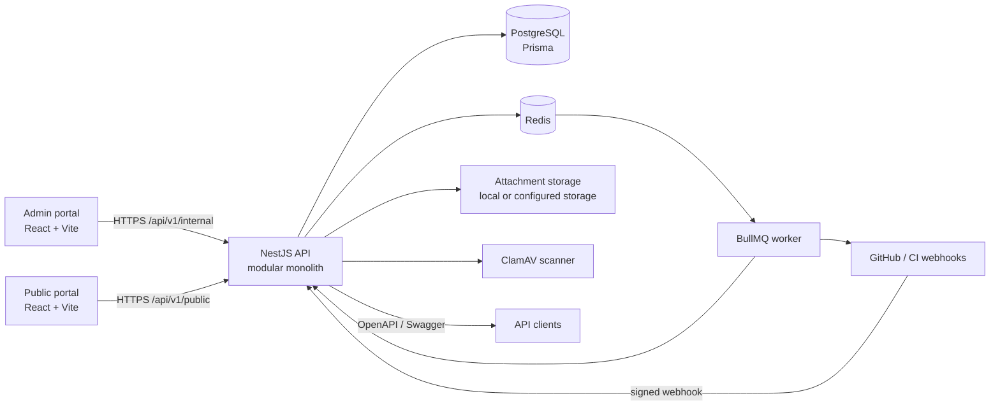
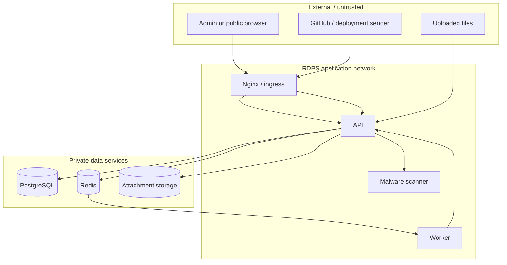

# RDPS architecture overview

**Status:** implementation-grounded overview  
**Reviewed:** 2026-11-11  
**Design authority:** [Full product design](../superpowers/specs/2026-11-10-rdps-full-product-design.md)

## System shape

RDPS is implemented as a TypeScript monorepo with two React web applications, a NestJS modular API, and a separate BullMQ worker. PostgreSQL is the durable system of record; Redis supports asynchronous work and rate limiting. Docker Compose provides development and production-oriented topologies. Production deployment details and known limitations are in [Production deployment](../operations/production-deployment.md).

## Runtime responsibilities

| Component         | Responsibility                                                                                                        | Evidence in repository                                                       |
| ----------------- | --------------------------------------------------------------------------------------------------------------------- | ---------------------------------------------------------------------------- |
| `apps/admin-web`  | Internal authoring, release management, review and operations UI                                                      | React/Vite application                                                       |
| `apps/public-web` | Public release and changelog pages                                                                                    | React/Vite application                                                       |
| `apps/api`        | HTTP API, identity, projects, releases, publishing, public delivery, integrations, analytics and other domain modules | NestJS controllers/services; global prefix `/api/v1`; Swagger at `/api/docs` |
| `apps/worker`     | Asynchronous jobs, webhook processing and scheduled/background work                                                   | Separate worker entry point; BullMQ/Redis integration                        |
| PostgreSQL        | Durable RDPS records, publication history, audit and configuration                                                    | Prisma schema and migrations under `database/prisma`                         |
| Redis             | Queue transport and transient coordination such as rate-limit counters                                                | API and worker configuration                                                 |
| ClamAV            | Malware scanning for uploaded attachments in production-oriented Compose                                              | `CLAMAV_*` runtime configuration; production deployment guide                |
| Nginx             | Static delivery and API proxy in production-oriented web image                                                        | `infrastructure/nginx` and production Docker target                          |

## Request and background flows

### Internal authoring and publication

1. The admin web app calls the authenticated internal API.
2. API guards establish the caller identity. Application services apply project and capability checks; database reads/writes use project identifiers.
3. Release content and review decisions persist in PostgreSQL. Activity is recorded in audit records by the relevant commands.
4. Publishing requires an explicit review/approval and publish operation. The public delivery layer reads publication snapshots, not internal release records.
5. Unpublishing revokes public access while retaining publication history.

### Public delivery

The public web app calls the `/api/v1/public` endpoints. Project, release, changelog, search, feed, sharing, and public attachment responses are built by public delivery services and scoped to public publications. Public HTTP responses have a cache interceptor; endpoints that must not be cached explicitly set `no-store`.

### Integrations and jobs

Webhook controllers validate source-specific requests and persist/queue work. Workers process jobs asynchronously and call domain services through the API integration boundary. Duplicate delivery handling and retry behavior are part of the integration path. Incoming source events may create suggestions or deployment records; they do not constitute publication approval.

## Trust boundaries and data classes

- **Internal content:** drafts, internal notes, review comments, membership and audit data. Treat as confidential organization data.
- **Public content:** only approved, published snapshot fields and public attachments. Treat as intentionally public.
- **Credentials and secrets:** session/token material, integration secrets, signing keys and database credentials. Keep in runtime secret configuration; never put them in release content or generated docs.
- **Integration payloads and uploads:** untrusted inputs; validate, authenticate, constrain size and scan files before serving.

The threat analysis is maintained in [Threat model](../security/threat-model.md). The security reporting process is in [Security disclosure policy](../security/disclosure-policy.md).

## Important design decisions

- [ADR-001: Modular monolith and worker boundary](adr-001-modular-monolith.md)
- [ADR-002: Immutable public publication snapshots](adr-002-publication-snapshots.md)

## Implementation status and limits

The full product design is broader than the current implementation. The diagram and components above describe repository-backed implementation. The design document lists the full target; any capability absent from current API schemas, migrations or applications remains planned or incomplete. In particular, do not infer production availability, formal WCAG 2.2 AA conformance, external identity-provider deployment, or customer-operated recovery guarantees from this overview. See the deployment and backup/restore runbooks for operational prerequisites and limits.

## Updating this overview

Update the component inventory and flows when adding/removing runtime services, changing the internal/public boundary, changing the publication source of truth, or moving durable data. Keep runtime facts tied to repository paths and keep target-product statements explicitly labeled.
